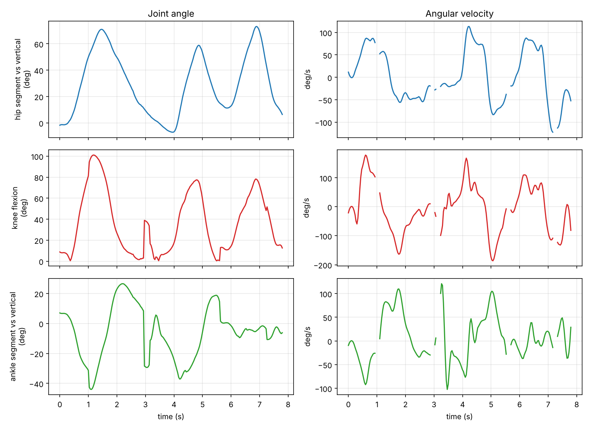

# Computer-Vision-Based Biomechanical Motion Analysis

A computer-vision biomechanics analyser: track coloured skin markers in video, segment the limb,
and turn the tracks into joint angles, angular velocities, range of motion and repetition counts.

Course project for **BSE 643/443 Applied Biomechanics**, M.Tech. Biomedical Devices Engineering,
IIT Indore (Arjeeta Singh, 2502171003 · Shashank Shinde, 2502171020).

The project has two parts that share the same method:

| Part | Where | What it is |
|---|---|---|
| Course MATLAB programs | `matlab/original_assignments/` | Assignment 2 (limb segments), Assignment 3 leg (hip-knee-ankle angles) and Assignment 3 arm (shoulder-elbow-wrist angles) |
| Improved toolchain | `biomech/` (Python) and `matlab/track_limb_joint_angles.m` | Identity-preserving marker tracking, glitch repair, signed joint kinematics, report and annotated video |

## Demo on the course video

The side-view leg recording (red stickers at hip, knee and ankle, 7.8 s, 30 fps) was analysed from
the tracked points of the original MATLAB program (see "Data" below).

| Angle (deg) | Min | Max | Range | Peak speed (deg/s) |
|---|---|---|---|---|
| Hip (thigh vs vertical) | -7.1 | 73.1 | 80.2 | 122 |
| Knee flexion | 0.4 | 101.0 | 100.6 | 187 |
| Shank vs vertical | -44.0 | 26.6 | 70.6 | 121 |

Three leg-raise repetitions were found (peaks at 1.2, 4.8 and 6.9 s) with peak knee flexion 101.0, 77.4
and 78.2 degrees. A fourth candidate peak coincided with a tracking jump and was rejected (`results/pri_leg/repetitions.csv`).



More figures are in `results/pri_leg/`: range of motion, hip-knee phase portrait, marker paths and the
tracking quality plot. `media/` has the two original output videos and a stick-figure animation made
from the tracked points.

### What the analysis found about the original tracker

The original programs take the three lowest red blobs in every frame and sort them by height
(top = hip, middle = knee, bottom = ankle). Other red patches are visible in the frame, so the "ankle"
label most likely switches between blobs. In this video the ankle track makes 5 jumps of roughly 50 to 130 px in one frame
(a foot cannot move that fast), which show up as steps in knee flexion near 3.0 s and 5.6 s. The hip
and knee tracks are clean. The cleaning stage flags such jumps and never smooths across them; the real fix is
in the tracker (below) and needs the raw video.

## Install and run

```bash
pip install -r requirements.txt

# 1) from a raw video with red stickers (hip, knee, ankle from top to bottom in frame 1)
python -m biomech preview  my_leg.mp4                      # check the numbered blobs in frame 1
python -m biomech track    my_leg.mp4 --out results/my_leg --joint-set leg
python -m biomech track    my_arm.mp4 --out results/my_arm --joint-set arm   # shoulder, elbow, wrist

# 2) from a CSV of marker positions (MATLAB output, or points from another tracker)
python -m biomech analyze data/pri_leg_points_from_annotated_video.csv --fps 30.02 --out results/pri_leg

python -m pytest tests          # 14 unit tests
```

Useful options: `--facing right|left|auto`, `--init-points "x1,y1 x2,y2 x3,y3"` (when frame 1 shows extra red
blobs), `--mask rgb|hsv`, `--gate-px`, `--smooth-s`, `--slowdown 2`. Every run writes:
`trajectories_clean.csv`, `joint_angles.csv`, `summary.csv`, `repetitions.csv`, `run_info.json`, five figures,
`annotated.mp4` (track mode) and `stick_figure.mp4`.

In MATLAB: `results = track_limb_joint_angles('PRI.mp4');` writes the same kind of CSVs
(`*_points.csv` can go straight into `python -m biomech analyze`).

## Method in short

1. **Detect** red markers (`R > 1.3 G`, `R > 1.3 B`, `R > 30` as in the course code, or hue-wrap aware HSV), clean the mask, take blob centroids.
2. **Track** with a constant-velocity Kalman filter per marker and Hungarian assignment with a distance gate. Extra blobs are ignored and short occlusions are bridged by prediction.
3. **Clean**: repair lost or glitch frames with PCHIP interpolation, then Savitzky-Golay smoothing on each side of any detected jump.
4. **Angles**: proximal segment vs vertical (signed), middle-joint flexion (180° minus the included angle), distal segment vs vertical (signed), plus the three "legacy" angle definitions used in the MATLAB assignments so numbers can be compared. Velocities and accelerations come from the Savitzky-Golay derivative.
5. **Report**: range of motion, peak velocity, repetitions (peaks of knee or elbow flexion), segment-length stability as a tracking check.

Details, equations and validation: [`docs/METHODS.md`](docs/METHODS.md).

## Data

`data/pri_leg_points_from_annotated_video.csv` holds hip, knee and ankle pixel positions per frame. The raw
`PRI.mp4` was not available, so the points were recovered from the course output video, which has a yellow
circle burnt in at every tracked point (`tools/extract_points_from_annotated_video.py`). They therefore include
the original tracker's mistakes. Recovered angles match the angles printed by the MATLAB program on the
video to within about one degree (see METHODS.md).

## Repository layout

```
biomech/        markers.py (detection + tracking), kinematics.py, report.py, video.py, cli.py
matlab/         track_limb_joint_angles.m, original_assignments/
tools/          extract_points_from_annotated_video.py
tests/          unit tests (angles, cleaning, tracker on synthetic video with a distractor and an occlusion)
data/  results/  media/  docs/
```

## Limitations

* Two-dimensional analysis: the camera must be perpendicular to the plane of motion; angles are projected angles.
* Three markers give three angles; there is no foot marker, so the "ankle" value is the shank orientation, not ankle dorsiflexion.
* Pixel units only unless you add a scale (a known segment length would give metres).
* The Python tracker is tested on synthetic video; run `preview` and check the first frames on your own recordings. `track_limb_joint_angles.m` was written together with the Python tool but could not be run in the environment where this repository was prepared.

## Possible extensions

Marker-less pose estimation (for example MediaPipe Pose) as an alternative front end, a foot marker for
ankle dorsiflexion, camera calibration for metric speeds, and gait-cycle detection for walking trials.
